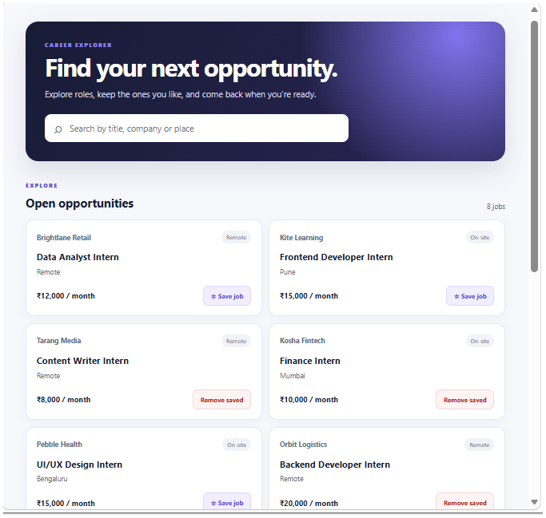
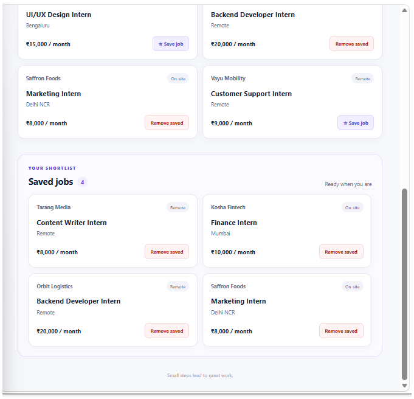

# Job Board – Saved Jobs Feature

A simple and responsive Job Board application that allows users to explore job opportunities, search for relevant positions, and save jobs for later.

The application includes a Saved Jobs feature with server-side JSON file persistence, allowing users to manage their saved job opportunities.

## Live Demo

🚀 **Live Application:** https://insiderone-job-board.onrender.com/

📂 **GitHub Repository:** https://github.com/ammu1348/insiderone-job-board

## Features

### Job Board
- Browse available job opportunities.
- Search jobs using keywords.
- View job listings and relevant information.
- Access the job board through a responsive interface.

### Saved Jobs
- Save interesting jobs for later.
- View saved jobs in a dedicated section.
- Remove jobs from the saved list.
- Prevent duplicate saved job entries.
- Store saved job IDs using server-side JSON file persistence.
- Retrieve complete job details from the existing jobs data.

## Screenshots

### 1. Job Board



### 2. Saved Jobs



## Technology Stack

- **Runtime:** Node.js 20+
- **Backend:** Node.js
- **Frontend:** HTML, CSS, JavaScript
- **Storage:** JSON file-based persistence
- **Testing:** Node.js Built-in Test Runner
- **Deployment:** Render
- **Version Control:** Git and GitHub

## API Documentation

The application provides REST API endpoints to manage job listings and saved jobs.

| Method | Endpoint | Description |
|---|---|---|
| GET | `/api/jobs` | Retrieve all job listings |
| GET | `/api/jobs?q=keyword` | Search jobs |
| GET | `/api/saved` | Retrieve saved jobs |
| POST | `/api/saved` | Save a job |
| DELETE | `/api/saved/:jobId` | Remove a saved job |

### Save a Job

**POST** `/api/saved`

Request body:

```json
{
  "jobId": "job-id"
}
```

The API validates the job ID and adds it to the saved jobs list.

### Get Saved Jobs

**GET** `/api/saved`

Returns the complete details of all saved jobs.

### Remove a Saved Job

**DELETE** `/api/saved/:jobId`

Removes the specified job from the saved jobs list.

## Technical Decisions

### 1. Server-side JSON Persistence

Used server-side JSON file storage instead of introducing an external database dependency.

### 2. Store Only Job IDs

The application stores saved job IDs rather than duplicating complete job records. Job details are retrieved from the existing jobs data.

### 3. Duplicate Prevention

Implemented duplicate checking to prevent the same job from being saved multiple times.

### 4. Safe File Mutations

Serialized save and remove operations using a mutation queue to prevent simultaneous requests from overwriting each other's changes.

### 5. Error Handling

Added validation for invalid JSON requests, missing job IDs, and unknown jobs.

## Project Structure

```text
insiderone-job-board/
│
├── lib/
│   ├── jobs.js
│   └── saved.js
│
├── public/
│   ├── index.html
│   ├── app.js
│   └── styles.css
│
├── test/
│
├── jobs.json
├── saved-jobs.json
├── server.js
├── package.json
├── .gitignore
├── README.md
├── job-board.png
└── saved-jobs.png
```

## Installation and Setup

### Prerequisites

- Node.js 20 or later
- npm

### 1. Clone the Repository

```bash
git clone https://github.com/ammu1348/insiderone-job-board.git
```

### 2. Navigate to the Project

```bash
cd insiderone-job-board
```

### 3. Install Dependencies

```bash
npm install
```

### 4. Start the Application

```bash
npm start
```

Open your browser:

```text
http://localhost:3000
```

## Running Tests

Run the automated test suite:

```bash
npm test
```

The project uses Node.js built-in test runner.

## Deployment

The application is deployed using Render.

**Live URL:** https://insiderone-job-board.onrender.com/

Deployment configuration:

| Setting | Value |
|---|---|
| Platform | Render |
| Runtime | Node.js |
| Branch | main |
| Build Command | `npm install` |
| Start Command | `npm start` |
| Port | Environment-provided `PORT` |

**Note:** The current implementation uses local JSON file storage. Render's free instance has an ephemeral filesystem, so saved-job data may not survive instance replacement or redeployment. A persistent database or disk can be introduced for long-term production storage.

## Future Improvements

- User authentication and individual saved-job lists.
- Database integration using SQLite or PostgreSQL.
- Improved loading and error states.
- Additional automated tests.
- Advanced job filtering and sorting.

---

## Project Links

- 🌐 [Live Application](https://insiderone-job-board.onrender.com/)
- 💻 [GitHub Repository](https://github.com/ammu1348/insiderone-job-board)
